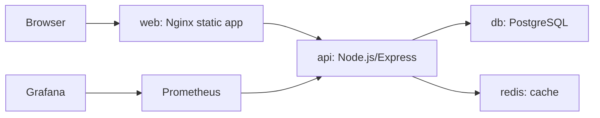

# OpsBoard Architecture

OpsBoard is a small but production-shaped platform. It is designed to show how a service owner thinks about runtime behavior, not only how to make containers start.

## Runtime Flow



## Service Responsibilities

- `web`: Serves the OpsBoard dashboard, proxies API traffic, exposes security headers, and keeps the public surface small.
- `api`: Owns validation, persistence, caching, metrics, readiness, and graceful shutdown.
- `db`: Stores durable todo state.
- `redis`: Caches the todo list and demonstrates cache hit/miss telemetry.
- `prometheus`: Scrapes API metrics and evaluates alert rules.
- `grafana`: Loads provisioned dashboards, contact points, and managed alert rules.

## Shortlist Signals

- One-command local operation with `make up`.
- End-to-end smoke testing with create, list, update, and delete flows.
- Quality gates covering lint, tests, dependency audit, and Compose validation.
- Observability from day one: health, readiness, metrics, dashboards, and alerts.
- Deployment path included for a free Oracle VM plus GitHub Actions.

## Operational Checks

```bash
make quality
make up
make smoke
docker compose ps
curl http://localhost:8080/metrics
```
